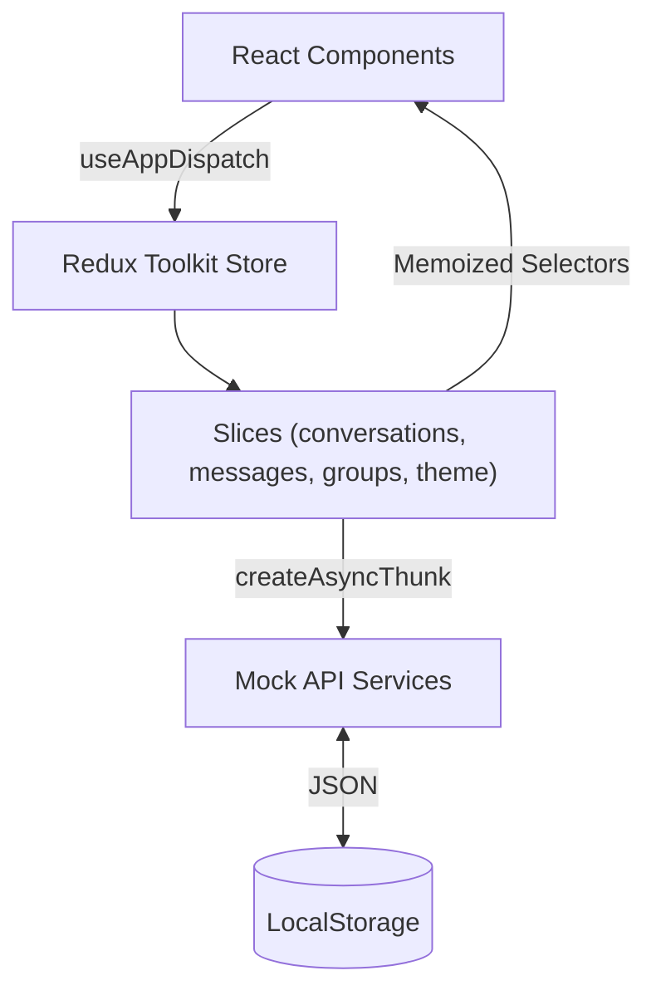

# NEXORA — Modern Chat Application

A responsive team and direct messaging application built with **React**, **TypeScript**, **Tailwind CSS**, and **Redux Toolkit**. Designed with midnight dark and daylight themes, a three-pane desktop layout, and a full-screen mobile chat view.

## Key Features

- **Conversations & Search**: Direct and group chats, `All` / `Unread` / `Groups` filters, debounced search, unread badges, priority flags, and online/offline presence indicators.
- **Messaging**: Send (`Enter` / `Shift + Enter`), edit (`edited` indicator), delete with confirmation, quoted replies, threaded replies panel, pin/unpin messages, copy-to-clipboard toast, emoji picker & reactions, inline formatting (`**bold**`, `` `code` ``, links), and date-grouped history.
- **File & Offline Support**: Local image/file attachment previews with lightbox, historical message pagination, simulated typing/delivery/read lifecycle, and offline message queuing.
- **Group & Contact Info**: View contact profiles or manage group details and members (add/remove) via mock services.
- **Keyboard & Persistence**: `Ctrl + K` / `Cmd + K` command palette, Dark/Light theme toggle, and `localStorage` persistence.

## Tech Stack

- **React 19** + **Vite** + **TypeScript**
- **Tailwind CSS v4** + **Lucide React**
- **Redux Toolkit** + **React Redux**
- **React Hook Form**
- **Vitest** + **React Testing Library**

## Getting Started

```bash
npm install      # Install dependencies
npm run dev      # Start dev server (http://localhost:5173)
npm test         # Run unit and interaction tests
npm run build    # Type-check and build for production
npm run lint     # Run linter
```

## Architecture & State Management

Global state is managed by four Redux Toolkit slices (`conversations`, `messages`, `groups`, `theme`), while transient UI state (open modals, menus, input drafts) stays in local React state. Mock Promise-based services in `src/services/` simulate API latency and persist updates to `localStorage`.



### Performance & 10,000+ Messages

- Uses `React.memo`, memoized `createSelector` hooks, debounced search, lazy-loaded `CommandPalette`, and proper cleanup for timers and window listeners.
- To support **10,000+ messages** per conversation, `MessageList` can adopt `@tanstack/react-virtual` (`useVirtualizer` with `measureElement`) so only visible rows render in the DOM ($O(1)$) while preserving scroll-to-match behavior.

## Screenshots

> Add desktop, dark/light theme, and mobile screenshots here.
