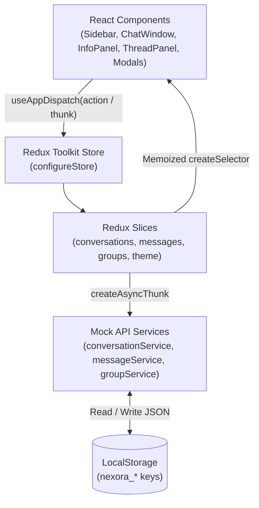

# NEXORA — Modern Chat Application

**NEXORA** is a responsive, production-oriented team and direct messaging application built with **React**, **TypeScript**, **Tailwind CSS**, and **Redux Toolkit**. Designed with an original midnight charcoal and daylight aesthetic, electric violet accents, and a focused three-pane messaging layout across desktop, tablet, and mobile viewports.

---

## Table of Contents

- [Overview & Features](#overview--features)
- [Technology Stack](#technology-stack)
- [Getting Started](#getting-started)
- [Project Structure](#project-structure)
- [Architecture Diagram](#architecture-diagram)
- [Redux Toolkit State Management](#redux-toolkit-state-management)
- [Mock API Services & Real-Time Simulation](#mock-api-services--real-time-simulation)
- [LocalStorage Persistence](#localstorage-persistence)
- [Responsive Design](#responsive-design)
- [Keyboard Shortcuts](#keyboard-shortcuts)
- [Performance & Scaling to 10,000+ Messages](#performance--scaling-to-10000-messages)
- [Testing](#testing)
- [Screenshots](#screenshots)
- [Limitations & Future Improvements](#limitations--future-improvements)
- [GitHub Submission (`nexora`)](#github-submission-nexora)

---

## Overview & Features

### Conversation Sidebar
- Current user profile header with online status indicator, quick-jump (`Ctrl + K`), new direct chat, new group, and Light/Dark theme toggle.
- Debounced conversation search (`200ms`) with clear control and empty-state recovery.
- Filter tabs for **All**, **Unread** (with live total unread badge), and **Groups**.
- Unread count badges, priority star indicators, delivery status ticks, relative timestamps, and online/away/offline presence dots.

### Main Chat Window
- Conversation header with online/last-seen metadata, priority toggle, pinned-message counter, in-chat message search, and contextual Info panel toggle.
- Optimistic message sending (`Enter` to send, `Shift + Enter` for newline) with offline message queuing and automatic queue flush on reconnect.
- Local file and image attachments (file picker + clipboard image paste) with removable pre-send thumbnails, downloadable file cards, and an Escape-dismissible image lightbox.
- Safe inline formatting for `**bold**`, `` `inline code` ``, and clickable `https://` links without `dangerouslySetInnerHTML`.
- Historical message pagination (**Load earlier messages** + scroll-top trigger) with `scrollHeight` delta scroll-position preservation.
- Edit own messages (with `edited` label) and delete messages with a confirmation dialog.
- Quoted replies **and** side-panel **Threaded Replies**.
- Pin/unpin messages, copy-to-clipboard toast notification, emoji picker, toggleable emoji reactions, hover action bar, and right-click context menu.
- Date-grouped message timeline (`Today`, `Yesterday`, formatted dates) with smart auto-scroll that stays put when reading older history.
- Simulated `sending → sent → delivered → read` status lifecycle, typing indicators, and automated peer replies with proper timer cleanup.

### Conversation & Group Information Panel
- **Direct conversations**: Displays user avatar, online/away/offline status, last seen timestamp, role, department, priority toggle, and shared groups.
- **Group conversations**: Displays group avatar, name, description, member count, editable name/description, member profiles with online status, and add/remove member actions.

---

## Technology Stack

| Layer | Technology |
| --- | --- |
| UI Framework | React 19 + Vite |
| Language | TypeScript (strict mode, zero `any`) |
| Styling | Tailwind CSS v4 (`@tailwindcss/vite` + CSS variables) |
| State Management | Redux Toolkit + React Redux |
| Forms & Validation | React Hook Form |
| Icons | Lucide React |
| Testing | Vitest + React Testing Library + `@testing-library/user-event` |
| Persistence | Browser `localStorage` |

---

## Getting Started

### Prerequisites
- Node.js `>= 18`
- npm `>= 9`

### Installation & Commands

```bash
# Install dependencies
npm install

# Start the development server (http://localhost:5173)
npm run dev

# Run the Vitest unit and interaction test suite
npm test

# Run tests in watch mode
npm run test:watch

# Type-check and generate the production build
npm run build

# Lint the codebase with oxlint
npm run lint

# Preview the production build locally
npm run preview
```

---

## Project Structure

```text
src/
├── app/
│   ├── hooks.ts                    # Typed useAppDispatch & useAppSelector hooks
│   └── store.ts                    # configureStore & per-test setupStore factory
├── components/
│   ├── common/                     # Avatar, ThemeToggle, EmptyState, LoadingState, Toast
│   ├── layout/                     # AppLayout (responsive 3-pane / mobile shell)
│   └── modals/                     # CommandPalette, NewConversationModal, NewGroupModal, EditGroupModal, EditMessageModal, DeleteConfirmationModal, AddMemberModal
├── data/
│   ├── mockConversations.ts        # Seeded direct & group conversations
│   ├── mockMessages.ts             # Seeded messages, quoted replies, threads & pins
│   └── mockUsers.ts                # User directory & offline-safe SVG avatars
├── features/
│   ├── conversations/              # Sidebar, ProfileHeader, ConversationSearch, ConversationFilter, ConversationList, ConversationItem, slice & selectors
│   ├── groups/                     # GroupInfoPanel, ContactInfoPanel, GroupMemberList, slice & selectors
│   ├── messages/                   # ChatWindow, ChatHeader, PinnedMessagesBar, MessageList, MessageBubble, MessageActions, MessageInput, ThreadPanel, TypingIndicator, EmojiPicker, slice & selectors
│   └── theme/                      # themeSlice (Dark/Light mode)
├── hooks/
│   ├── useChatSimulation.ts        # Delivery/read status, typing indicator & reply simulation
│   ├── useDebounce.ts              # Debounce hook
│   └── useKeyboardShortcut.ts      # Global Ctrl+K / Cmd+K shortcut listener with cleanup
├── services/
│   ├── apiHelpers.ts               # Simulated network delay & ID generation
│   ├── conversationService.ts      # Promise-based conversation CRUD
│   ├── groupService.ts             # Promise-based group details & member management
│   └── messageService.ts           # Promise-based message CRUD & pagination
├── types/
│   ├── conversation.types.ts
│   ├── message.types.ts
│   ├── theme.types.ts
│   ├── user.types.ts
│   └── index.ts
├── utils/
│   ├── dateUtils.ts                # Date separators, relative timestamps & last seen formatting
│   ├── messageUtils.ts             # Date grouping, initials & preview truncation
│   └── storage.ts                  # Safe localStorage get/set helpers
├── App.tsx
├── index.css
└── main.tsx
tests/
├── advancedFeatures.test.tsx
├── conversations.test.tsx
├── groupsAndWorkspace.test.tsx
├── messages.test.tsx
├── proFeatures.test.tsx
├── setup.ts
├── store.test.tsx
└── testUtils.tsx
```

---

## Architecture Diagram



### Data Flow Summary

1. **User Action**: Interactions in components (sending a message, toggling a reaction, filtering conversations, or editing a group) dispatch typed Redux actions or async thunks via `useAppDispatch`.
2. **Async Service Layer**: Thunks delegate simulated network calls to `src/services/*`, which return Promises with realistic latency.
3. **Immutable Updates**: Redux Toolkit's Immer-powered reducers update normalized state (`byConversationId`, `groupsById`, `usersById`, `items`) and persist changes to `localStorage`.
4. **Targeted Re-renders**: Components subscribe through memoized `createSelector` hooks (`useAppSelector`) so updates in one slice (such as typing indicators) do not trigger unnecessary re-renders in unrelated views.

---

## Redux Toolkit State Management

| Slice | Responsibility | Async Thunks | Persisted |
| --- | --- | --- | --- |
| `conversationSlice` | Conversation list, active selection, search, `All`/`Unread`/`Groups` filters, priority flags, unread counts | `fetchConversations`, `startDirectConversation`, `createGroup` | Yes |
| `messageSlice` | Messages by `conversationId`, replies, threads, pins, reactions, search, typing state, offline queue, pagination | `fetchMessages`, `fetchOlderMessagesThunk`, `sendMessageThunk`, `flushOfflineQueueThunk`, `editMessageThunk`, `deleteMessageThunk` | Yes |
| `groupSlice` | User directory, online statuses, group details, members, info panel visibility | `updateGroupDetailsThunk`, `addGroupMemberThunk`, `removeGroupMemberThunk` | Yes |
| `themeSlice` | Dark / Light theme mode | — | Yes |

- **One-way slice dependency graph**: `conversationSlice` is a leaf slice; `messageSlice` and `groupSlice` import only from `conversationSlice` to sync `lastMessage` previews and `members` without circular imports.
- **Local vs. global state**: Ephemeral UI state (modal open flags, emoji picker popovers, context menu coordinates, message composer drafts) is kept in local React state.

---

## Mock API Services & Real-Time Simulation

- **Mock Services (`src/services/`)**: Promise-based APIs (`getConversations`, `getMessages`, `getOlderMessages`, `sendMessage`, `editMessage`, `deleteMessage`, `updateGroupDetails`, `addGroupMember`, `removeGroupMember`) using `simulateLatency` to mimic realistic backend responses.
- **Error Handling**: Failed service calls reject cleanly via `rejectWithValue`, rendering user-friendly `ErrorState` views with working **Retry** actions.
- **Real-Time Simulation (`src/hooks/useChatSimulation.ts`)**: Simulates `sending → sent → delivered → read` status ticks, typing indicators, and automated peer replies using tracked `setTimeout` refs that clean up on unmount.
- **Offline Queue**: Listens to browser `online` / `offline` events (and supports toggling offline mode from the `Ctrl + K` Command Palette). Messages sent offline render with a `Queued` badge and flush automatically in order once reconnected.

---

## LocalStorage Persistence

Managed safely in `src/utils/storage.ts` under `nexora_*` keys:
- `nexora_conversations`
- `nexora_messages`
- `nexora_groups`
- `nexora_selected_conversation`
- `nexora_theme_mode`

All reads and writes are wrapped in `try/catch` guards so restricted or quota-limited environments never crash the application.

---

## Responsive Design

| Breakpoint | Layout Behavior |
| --- | --- |
| **Desktop (`>= 1024px`)** | Three-column layout (`Sidebar` \| `ChatWindow` \| optional `GroupInfoPanel` / `ContactInfoPanel` / `ThreadPanel`). |
| **Tablet (`768px – 1023px`)** | Two-column layout (`Sidebar` \| `ChatWindow`) with slide-over backdrop drawers for Info and Thread panels. |
| **Mobile (`< 768px`)** | Master-detail flow: full-screen conversation list first; selecting a chat opens a full-screen `ChatWindow` (`100dvh`) with a Back button in `ChatHeader`, stacked mobile message actions, and safe-area composer padding. |

---

## Keyboard Shortcuts

| Shortcut | Action |
| --- | --- |
| `Enter` | Send message (inside composer) |
| `Shift + Enter` | Insert a new line (inside composer) |
| `Ctrl + K` / `Cmd + K` | Open / close Command Palette |
| `Escape` | Close active modal, emoji picker, context menu, or lightbox |
| Right-click on message | Open message context menu |

---

## Performance & Scaling to 10,000+ Messages

### Implemented Optimizations
- `React.memo` on `ConversationItem` and `MessageBubble` to prevent sibling re-renders.
- Memoized `createSelector` selectors returning stable module-level empty arrays (`EMPTY_MESSAGES`, `EMPTY_TYPING_USERS`, `EMPTY_MATCH_IDS`).
- Debounced conversation search (`200ms`) and `React.lazy` + `Suspense` code-splitting for `CommandPalette`.
- Strict cleanup of timers (`useChatSimulation`, `Toast`, `ConversationSearch`) and window event listeners (`useKeyboardShortcut`, `App`).

### Scaling to 10,000+ Messages (Virtualization Blueprint)
For conversations with 10,000+ messages, `MessageList` can flatten date separators and message rows into a single virtualized array powered by `@tanstack/react-virtual` (`useVirtualizer` with `measureElement` for variable-height bubbles):
1. Only ~20–30 visible rows plus a small overscan buffer remain mounted in the DOM, keeping memory and layout cost $O(1)$.
2. `virtualizer.scrollToIndex(idx)` replaces direct DOM ref scrolling for jumping to search matches and pinned messages.
3. Combined with `fetchOlderMessagesThunk`, historical pages load incrementally on scroll-up while preserving scroll offset.

---

## Testing

```bash
npm test
```

Vitest + React Testing Library suites in `tests/`:
- `tests/store.test.tsx`: Four-slice store defaults and Light/Dark theme `localStorage` persistence.
- `tests/conversations.test.tsx`: Conversation list rendering, debounced search + empty state, `All` / `Unread` / `Groups` filters, and selection clearing unread counts.
- `tests/messages.test.tsx`: Sending via `Enter`, editing (`edited` label), deleting with confirmation, quoted replies, threaded replies panel, emoji reactions, and clipboard copy toast.
- `tests/groupsAndWorkspace.test.tsx`: Adding/removing group members and `Ctrl + K` Command Palette navigation.
- `tests/advancedFeatures.test.tsx`: New group form validation, editing group details, in-chat message search navigation, pinned messages bar, mobile back navigation, API error/retry recovery, and individual contact info panel.
- `tests/proFeatures.test.tsx`: Offline message queue & reconnect flush, file attachment preview & send, historical pagination (**Load earlier messages**), and safe inline bold/code/link rendering.

---

## Screenshots

> Run `npm run dev` and capture screenshots of the desktop dark view, daylight mode, group info panel, and mobile full-screen chat view to attach here.

---

## Limitations & Future Improvements

- **Client-side real-time simulation**: Peer replies, typing indicators, and delivery/read ticks are simulated locally rather than powered by WebSockets or Server-Sent Events.
- **List virtualization**: Paginated loading is active, while full viewport virtualization (`@tanstack/react-virtual`) is documented above for 10,000+ message histories.
- **Voice & rich media**: Local file and image attachments with lightbox preview are supported; audio notes and link OpenGraph unfurling can be added next.

---

## GitHub Submission (`nexora`)

```bash
git add .
git commit -m "feat: implement NEXORA chat application"
git remote set-url origin https://github.com/<your-username>/nexora.git
git push -u origin main
```
